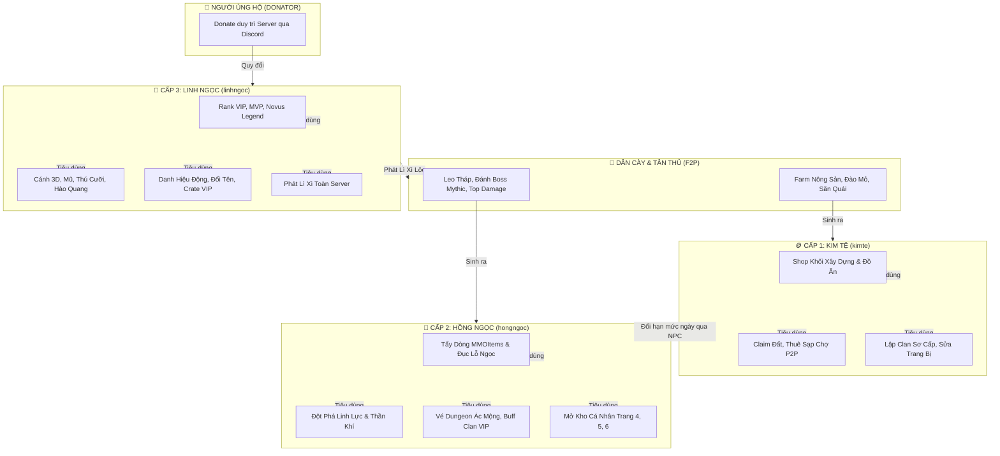

# ⚔️ CẨM NANG TOÀN TẬP MÁY CHỦ NOVUSMC ⚔️
## HỆ THỐNG LỐI CHƠI & ĐẠI KINH TẾ 3 CẤP (3-TIER ECONOMY)

> **Máy chủ:** NovusMC - Survival RPG 1.21+  
> **Phiên bản tài liệu:** 2.0 (Cập nhật hệ thống kinh tế tam nguyên & chuẩn hóa MMORPG)  
> **Kênh hỗ trợ & Nạp thẻ:** Discord NovusMC Official  

---

## MỤC LỤC
1. [Giới Thiệu Tổng Quan Về Máy Chủ NovusMC](#i-giới-thiệu-tổng-quan-về-máy-chủ-novusmc)
2. [Triết Lý Cân Bằng Kinh Tế Tam Nguyên (3-Tier Economy)](#ii-triết-lý-cân-bằng-kinh-tế-tam-nguyên-3-tier-economy)
3. [Cấp 1: KIM TỆ (kimte) - Tiền Tệ Sinh Hoạt & Giao Thương Phổ Thông](#iii-cấp-1-kim-tệ-kimte---tiền-tệ-sinh-hoạt--giao-thương-phổ-thông)
4. [Cấp 2: HỒNG NGỌC (hongngoc) - Tiền Tệ Tinh Anh & Đột Phá RPG](#iv-cấp-2-hồng-ngọc-hongngoc---tiền-tệ-tinh-anh--đột-phá-rpg)
5. [Cấp 3: LINH NGỌC (linhngoc) - Tiền Tệ Quyên Góp & Đặc Quyền Tối Cao](#v-cấp-3-linh-ngọc-linhngoc---tiền-tệ-quyên-góp--đặc-quyền-tối-cao)
6. [Sơ Đồ Tuần Hoàn & Tương Tác Giữa 3 Loại Tiền](#vi-sơ-đồ-tuần-hoàn--tương-tác-giữa-3-loại-tiền)
7. [Bảng Tra Cứu Lệnh & Cú Pháp Giao Dịch In-Game](#vii-bảng-tra-cứu-lệnh--cú-pháp-giao-dịch-in-game)
8. [Quy Tắc Vàng Giữ Gìn Kinh Tế Ổn Định & Chống Lạm Phát](#viii-quy-tắc-vàng-giữ-gìn-kinh-tế-ổn-định--chống-lạm-phát)

---

## I. GIỚI THIỆU TỔNG QUAN VỀ MÁY CHỦ NOVUSMC

**NovusMC** là máy chủ Minecraft sinh tồn nhập vai (Survival MMORPG) hiện đại, kết hợp hài hòa giữa lối chơi xây dựng, khai hoang sinh tồn truyền thống với hệ thống phát triển nhân vật chuyên sâu:
* **Hệ thống Nhân vật & Chiến đấu:** Tích hợp `MMOCore` và `MMOItems` với đa dạng chức nghiệp, bộ kỹ năng chủ động/bị động, thuộc tính trang bị ngẫu nhiên, ngọc khảm và cường hóa.
* **Hệ sinh thái Thử thách & Thám hiểm:** Boss thế giới MythicMobs (`Kragan`, `Vael`,...), tháp vô tận (`NovusLeoThap`), phụ bản bí cảnh và hệ thống quái phân cấp theo khu vực (`LevelledMobs`).
* **Nông nghiệp & Ngư nghiệp Hiện đại:** Trồng trọt chuyên sâu theo mùa (`CustomCrops`) và săn bắt các loài thủy quái biển sâu (`CustomFishing`).
* **Hệ thống Xã hội & Bang hội:** Bang hội liên minh (`ClansPlus`), thị trường giao thương tự do giữa người chơi (`PlayerMarket`), rương đồ cá nhân đa tầng (`NovusKhoCaNhan`) và phong bao lì xì may mắn (`NovusLixi`).

Để đảm bảo máy chủ vận hành công bằng, dân cày (Free-to-Play) có thể đạt được đỉnh cao sức mạnh bằng thực lực và thời gian, còn người ủng hộ (Donator) nhận được những quyền lợi thẩm mỹ, tiện ích xứng đáng mà **không phá vỡ cán cân chiến đấu**, NovusMC áp dụng **Hệ thống Kinh Tế 3 Cấp**.

---

## II. TRIẾT LÝ CÂN BẰNG KINH TẾ TAM NGUYÊN (3-TIER ECONOMY)

Hệ thống kinh tế NovusMC được phân chia thành 3 lớp riêng biệt, mỗi lớp có nguồn sinh ra (Inflow) và nguồn tiêu thụ (Sink) được tính toán nghiêm ngặt:

| Tiêu chí | Cấp 1: KIM TỆ (`kimte`) | Cấp 2: HỒNG NGỌC (`hongngoc`) | Cấp 3: LINH NGỌC (`linhngoc`) |
| :--- | :--- | :--- | :--- |
| **Ký hiệu & Viết tắt** | 🪙 `kt` | 💎 `hn` | 🔮 `ln` |
| **Bản chất tiền tệ** | Tiền tệ phổ thông, thông dụng | Tiền tệ tinh anh, bán cao cấp | Tiền tệ đóng góp / Quyên góp |
| **Độ hiếm** | Phổ biến (Người chơi nào cũng có) | Hiếm vừa (Đòi hỏi thời gian & kỹ năng) | Độc quyền (Không thể farm tự do) |
| **Định dạng số dư** | Số thực (`Decimal: true`, ví dụ: 100.50 kt) | Số nguyên (`Decimal: false`, ví dụ: 25 hn) | Số nguyên (`Decimal: false`, ví dụ: 10 ln) |
| **Nguồn kiếm chính** | Nông nghiệp, quặng mỏ, câu cá, quái | Boss thế giới, Leo tháp, Top Dmg, Quests khó | Donate ủng hộ máy chủ qua Discord |
| **Mục đích chính** | Duy trì sinh hoạt, xây dựng, chợ P2P | Nâng cấp trang bị MMO, tẩy ngọc, đột phá | Thời trang 3D, Rank VIP, QoL, Crate VIP |
| **Cán cân P2W** | Hoàn toàn F2P | 100% cày bằng kỹ năng & thời gian | Không bán chỉ số "One-hit", giữ cân bằng |

---

## III. CẤP 1: KIM TỆ (kimte) - TIỀN TỆ SINH HOẠT & GIAO THƯƠNG PHỔ THÔNG

Kim Tệ là dòng máu nuôi dưỡng các hoạt động hằng ngày của toàn bộ cư dân NovusMC. Mọi tân thủ khi đặt chân vào thế giới đều sẽ tiếp xúc và tích lũy Kim Tệ đầu tiên.

### 1. Cách Kiếm Kim Tệ (Inflow)
* 🌾 **Làm nông nghiệp & Chăn nuôi chuyên sâu (`CustomCrops`):**
  * Trồng trọt các loại cây trồng cải tiến, tưới tiêu, bón phân đúng quy trình.
  * Bán nông sản tươi sống, hạt giống lai tạo và sản phẩm gia súc tại Cửa Hàng Nông Sản (`/shop`).
* ⛏️ **Khai khoáng & Thám hiểm Địa ngục (Mining):**
  * Khai thác quặng sắt, vàng, kim cương, than, đá cổ xưa.
  * Bán quặng thô hoặc thành phẩm đã nấu chín vào hệ thống thu mua tài nguyên.
* 🎣 **Ngư nghiệp cơ bản (`CustomFishing`):**
  * Câu các loại cá thường, cá sông, cá hồ và rác biển hữu ích để đổi lấy Kim Tệ.
* 🏹 **Tiêu diệt quái vật thường ngày (`LevelledMobs`):**
  * Đánh bại Zombie, Skeleton, Spider theo cấp độ khu vực để nhận Kim Tệ rơi trực tiếp vào tài khoản.
  * Bán chiến lợi phẩm quái vật (xương, da bò, mắt nhện, thuốc súng).
* 📜 **Nhiệm vụ tân thủ & Hằng ngày (`Quests`):**
  * Hoàn thành các nhiệm vụ khởi đầu ngày như chặt gỗ, thu hoạch lúa, thuần hóa thú nuôi.
* 🤝 **Giao thương người chơi (`/market`, `/ah`):**
  * Bán các khối xây dựng, đồ ăn, dụng cụ thừa cho người chơi khác để nhận Kim Tệ.
* 🧧 **Nhận Lì Xì Server (`NovusLixi`):**
  * Tranh thủ nhặt lì xì cộng đồng bằng lệnh `/laylixi` khi có người chơi phát lộc Kim Tệ.

### 2. Kim Tệ Dùng Để Làm Gì? (Sinks - Tiêu Dùng)
* 🧱 **Mua sắm vật tư xây dựng & Sinh tồn:** Mua các khối gạch, kính, gỗ men, đuốc, thức ăn cơ bản từ Cửa Hàng Hệ Thống (`/shop`).
* 🛡️ **Bảo vệ lãnh địa & Claim đất (`GriefPrevention`):** Chi trả phí tạo vùng bảo hộ, mở rộng diện tích lãnh thổ để chống quái phá và chống trộm.
* ⛺ **Chi phí dịch chuyển & Tiện ích:** Phí tạo điểm `/sethome`, dịch chuyển về nhà `/home`, phí thuê gian hàng chợ ảo `PlayerMarket`.
* 🔨 **Sửa chữa công cụ & Đe rèn:** Phí phục hồi độ bền vũ khí, dụng cụ tại các trạm rèn của làng.
* 🏴 **Thành lập Bang hội cấp 1 (`ClansPlus`):** Đóng phí tạo Clan sơ cấp và nâng số lượng thành viên cơ bản.
* 📦 **Mở rộng Rương cá nhân bậc thấp (`NovusKhoCaNhan`):** Mở khóa các trang rương 1, 2 và 3 để chứa khoáng sản.

---

## IV. CẤP 2: HỒNG NGỌC (hongngoc) - TIỀN TỆ TINH ANH & ĐỘT PHÁ RPG

> **Quy tắc danh dự:** Hồng Ngọc là bảo chứng cho **kỹ năng thực chiến và độ kiên trì** của người chơi. Không thể AFK farm máy tự động để sở hữu số lượng lớn Hồng Ngọc.

Hồng Ngọc là đơn vị tiền tệ trung và cao cấp, đóng vai trò then chốt trong chuỗi phát triển sức mạnh RPG (Endgame Progression).

### 1. Cách Kiếm Hồng Ngọc (Inflow)
* 👹 **Khiêu chiến Boss Thế Giới & Boss MythicMobs:**
  * Tham gia tiêu diệt các đại Boss như `Kragan`, `Vael`... Phần thưởng Hồng Ngọc rơi vào rương boss hoặc chuyển thẳng vào người chơi có cống hiến cao.
* 🏆 **Bảng Xếp Hạng Sát Thương Boss Tuần (`NovusBossTop`):**
  * Người chơi lọt Top 1 đến Top 5 sát thương boss tuần được vinh danh trên kênh Discord và nhận rương thưởng Hồng Ngọc dồi dào.
* 🗼 **Leo Tháp Vô Tận (`NovusLeoThap`):**
  * Mỗi khi vượt qua 5 hoặc 10 tầng tháp, hoặc hạ gục Tướng Giữ Tầng, người chơi sẽ nhận được lượng lớn Hồng Ngọc.
* 🪂 **Tranh đoạt Thính Rơi Chiến Trường (`UltimateAirdrops`):**
  * Mở các hòm thính chiến sự rơi ngẫu nhiên tại khu vực Thám Hiểm/PvP để nhận Hồng Ngọc.
* 🐋 **Câu Cá Huyền Thoại & Thủy Quái (`CustomFishing`):**
  * Câu trúng các loại Thủy Quái biển sâu hoặc Cá Thần Thoại và đổi chiến lợi phẩm lấy Hồng Ngọc.
* 🎖️ **Chuỗi Nhiệm Vụ Tinh Anh & Thử Thách Tuần (`Quests`):**
  * Tiêu diệt 100 quái tinh anh, vượt Dungeon độ khó cao hoặc hoàn thành các chỉ tiêu mùa.
* 🏛️ **Đóng góp Mốc Cống Nộp Server (`sukiencongnop`):**
  * Khi toàn thể máy chủ đạt mốc tài nguyên cống hiến, toàn bộ người tham gia nhận thưởng Hồng Ngọc.
* 💱 **NPC Đổi Tiền Hạn Mức (Money Changer):**
  * Người chơi cày nhiều Kim Tệ có thể quy đổi sang Hồng Ngọc tại NPC Ngân Hàng Trung Ương (ví dụ: `500,000 Kim Tệ = 10 Hồng Ngọc`, giới hạn tối đa 50 Hồng Ngọc/ngày để chống lạm phát).

### 2. Hồng Ngọc Dùng Để Làm Gì? (Sinks - Tiêu Dùng)
* ⚔️ **Tẩy luyện & Cải tạo Trang Bị MMO (`MMOItems`):**
  * **Tẩy dòng thuộc tính (Re-roll Stats):** Xóa các dòng chỉ số xấu, quay lại dòng chỉ số vàng/cam.
  * **Đục lỗ khảm ngọc (Socketing):** Mở khóa các khe cắm đá quý tăng sát thương chí mạng, hút máu, phòng thủ.
  * **Bảo thạch hộ mệnh:** Dùng khi đập trang bị cấp cao để chống tụt cấp hoặc vỡ đồ.
* 🧘 **Đột phá Linh Lực & Thần Khí (`nangcaplinhluc.sk`, `linhluc.sk`):**
  * Hồng Ngọc đóng vai trò là nguyên liệu tinh hoa để đột phá các tầng cảnh giới tu chân / võ đạo.
* 📜 **Tiệm Tinh Anh (Elite NPC Shop):**
  * Mua các cuốn sách Phù Phép Hiếm (`ExcellentEnchants`), cuộn giấy biến dị trang bị.
  * Mua thần dược tăng lực (bình thuốc tăng 20% sát thương lên Boss trong 30 phút, tăng may mắn rơi đồ).
* 🗝️ **Vé Khiêu Chiến Dungeon Ác Mộng:**
  * Mua chìa khóa mở cổng vào các khu vực cấm địa bí mật hoặc mua thêm lượt leo Tháp (`NovusLeoThap`).
* 🏰 **Nâng Cấp Bang Hội Đỉnh Cao (`ClansPlus`):**
  * Đóng góp Hồng Ngọc để mở các bùa lợi toàn Bang: +10% EXP nhận được, +5% Kháng sát thương, kho bang hội mở rộng.
* 🧰 **Mở Khóa Kho Cá Nhân Bậc Cao (`NovusKhoCaNhan`):**
  * Các trang rương số 4, 5, 6 đòi hỏi Hồng Ngọc để mở khóa vĩnh viễn.

---

## V. CẤP 3: LINH NGỌC (linhngoc) - TIỀN TỆ QUYÊN GÓP & ĐẶC QUYỀN TỐI CAO

Linh Ngọc là đơn vị tiền tệ độc quyền dành cho những thành viên hảo tâm đã đóng góp chi phí duy trì phần cứng, đường truyền và bảo dưỡng máy chủ NovusMC qua cổng Discord.

> **Cam kết cân bằng:** Linh Ngọc **KHÔNG** dùng để mua các trang bị "One-hit" hay vũ khí phá vỡ meta PvP/PvE. Toàn bộ tính năng quy đổi từ Linh Ngọc tập trung vào **Thẩm mỹ, Danh hiệu, Tiện ích chất lượng sống (Quality-of-Life) và Sự tự hào cá nhân**.

### 1. Cách Sở Hữu Linh Ngọc (Inflow)
* 💳 **Ủng hộ máy chủ qua Kênh Donate Discord (`NovusMCDiscordAll`):**
  * Tạo ticket hỗ trợ tại Discord chính thức của NovusMC và tiến hành nạp thẻ / chuyển khoản. Hệ thống Bot sẽ tự động tích điểm và cấp Linh Ngọc vào tài khoản nhân vật in-game.
* 🎁 **Quà tri ân & Sự kiện Đại Lễ:**
  * Nhận mã quà tặng Voucher Linh Ngọc trong các dịp kỷ niệm thành lập server, Tết cổ truyền hoặc giải đấu cộng đồng do Ban Quản Trị tổ chức.

### 2. Linh Ngọc Dùng Để Làm Gì? (Sinks - Tiêu Dùng)
* 👑 **Sở hữu Gói Đặc Quyền Rank VIP (`LuckPerms`):**
  * Mở các gói VIP (VIP, MVP, Novus Legend) với các quyền hạn tiện ích:
    * Lệnh bay xây dựng `/fly` trong khu vực lãnh địa đã claim.
    * Giữ lại điểm kinh nghiệm khi chẳng may tử trận (`keep-exp`).
    * Số lượng vị trí `/sethome` nhiều hơn người chơi thường.
    * Đặt chữ ký màu mè và chat định dạng nổi bật.
* 🪽 **Phụ Kiện Thời Trang 3D Độc Quyền (`HMCCosmetics`, `ModelEngine`):**
  * Trang bị các mẫu Cánh thiên thần, Quỷ vương, Hào quang tỏa sáng quanh người.
  * Đội mũ 3D, mặt nạ samurai, thú cưỡi cá nhân và hiệu ứng âm thanh bước chân huyền ảo.
* 🏷️ **Danh Hiệu Phát Sáng & Khung Tên (`EternalTags`, `CustomNameplates`):**
  * Mở khóa các thẻ danh hiệu động lấp lánh trên đầu nhân vật và trước tên trong khung chat.
* 📦 **Chìa Khóa Rương Báu VIP (`ExcellentCrates`):**
  * Mở các hòm báu Crate thời trang, sưu tập các mô hình trang trí căn cứ và skin vũ khí độc bản.
* 🛠️ **Tiện Ích Nâng Tầm Trải Nghiệm (Quality of Life):**
  * Thẻ đổi tên nhân vật hiển thị (`/nick`).
  * Vé chuyển đổi Nghề nghiệp/Chức nghiệp trong MMOCore mà không bị mất cấp độ đã cày.
  * Thẻ thiết lập lại toàn bộ điểm kỹ năng (Skill Reset).
  * Kích hoạt tính năng Tự động gom vật phẩm vào rương cá nhân (Auto-sort / Auto-pickup).
* 🧧 **Phát Lì Xì Đại Gia (`NovusLixi`):**
  * Tạo các phong bao lì xì Linh Ngọc chia lộc cho toàn thể server bằng lệnh `/lixi tao linhngoc <số lượng> <số phần>`.

---

## VI. SƠ ĐỒ TUẦN HOÀN & TƯƠNG TÁC GIỮA 3 LOẠI TIỀN

---

## VII. BẢNG TRA CỨU LỆNH & CÚ PHÁP GIAO DỊCH IN-GAME

Mọi người chơi có thể dễ dàng quản lý tài sản thông qua hệ thống lệnh chuẩn hóa của `ExcellentEconomy` và các plugin tích hợp:

### 1. Lệnh Kiểm Tra Số Dư
| Thao tác | Lệnh | Mô tả |
| :--- | :--- | :--- |
| Xem ví cá nhân | `/money` hoặc `/bal` | Hiển thị số dư Kim Tệ hiện có |
| Xem toàn bộ 3 loại tiền | `/ee bal` hoặc `/taikhoan` | Mở menu xem chi tiết Kim Tệ, Hồng Ngọc và Linh Ngọc |
| Xem ví người khác | `/bal <tên_người_chơi>` | Kiểm tra số dư công khai của người chơi khác |
| Xem Bảng xếp hạng giàu | `/baltop` hoặc `/ee baltop kimte` | Hiển thị danh sách đại gia Kim Tệ của server |

### 2. Lệnh Chuyển Tiền & Giao Thương Giữa Người Chơi
| Thao tác | Cú pháp | Ghi chú |
| :--- | :--- | :--- |
| Chuyển Kim Tệ | `/pay <tên_người_nhận> <số_tiền>` | Chuyển Kim Tệ trực tiếp (ví dụ: `/pay Hakito 10000`) |
| Chuyển Hồng Ngọc | `/ee pay <tên_người_nhận> hongngoc <số_lượng>` | Chuyển Hồng Ngọc (yêu cầu số nguyên) |
| Đăng bán chợ ảo | `/market create <giá_kimte>` | Cầm vật phẩm trên tay và treo giá lên chợ người chơi |
| Mua đồ trên chợ | `/market` hoặc `/ah` | Mở giao diện chợ buôn bán P2P |

### 3. Lệnh Phát Lì Xì Tri Ân (`NovusLixi`)
| Thao tác | Cú pháp | Ví dụ thực tế |
| :--- | :--- | :--- |
| Phát lì xì Kim Tệ | `/lixi tao kimte <tổng_tiền> <số_phần>` | `/lixi tao kimte 500000 10` (Phát 500k chia 10 người) |
| Phát lì xì Hồng Ngọc | `/lixi tao hongngoc <tổng_ngọc> <số_phần>` | `/lixi tao hongngoc 50 5` (Phát 50 ngọc chia 5 người) |
| Phát lì xì Linh Ngọc | `/lixi tao linhngoc <tổng_ngọc> <số_phần>` | `/lixi tao linhngoc 20 4` (Phát 20 ngọc chia 4 người) |
| Nhận lì xì đang phát | `/laylixi` | Nhận ngẫu nhiên 1 phần quà từ phong bao đang bay |

---

## VIII. QUY TẮC VÀNG GIỮ GÌN KINH TẾ ỔN ĐỊNH & CHỐNG LẠM PHÁT

Để đảm bảo giá trị đồng tiền trong NovusMC không bị mất giá sau nhiều tháng hoạt động, Ban Quản Trị cam kết thực hiện nghiêm ngặt các nguyên tắc sau:

1. **Kiểm Soát Máy Farm Tự Động (Anti-Auto Inflation):**
   * Các máy farm đá, quái vật tự động quá mức sẽ bị giới hạn tốc độ rơi đồ thông qua plugin cơ chế sinh thái.
   * Hồng Ngọc không bao giờ được thiết lập rơi từ quái vật spawn từ Spawner lồng quái.
2. **Cân Bằng Tỷ Lệ Thu - Chi (Inflow vs. Sink Equilibrium):**
   * Mỗi khi mở một nguồn kiếm tiền mới (ví dụ: Mở thêm phó bản kiếm Kim Tệ), server sẽ đồng thời bổ sung các hạng mục tiêu thụ Kim Tệ xứng đáng (thuế chợ, mở rộng rương, nâng cấp danh xưng).
3. **Minh Bạch & Chống Tiêu Cực:**
   * Nghiêm cấm mọi hành vi sử dụng lỗi bug dupe tiền, dupe vật phẩm. Mọi giao dịch bất thường sẽ được hệ thống Log máy chủ ghi lại tự động và xử lý nghiêm khắc.
4. **Bảo Vệ Người Chơi Ủng Hộ Không Bị Lợi Dụng:**
   * Linh Ngọc không thể quy đổi ngược trực tiếp ra tiền mặt, nhằm bảo vệ tính lành mạnh của cộng đồng giải trí.

---
*Tài liệu hướng dẫn chính thức được phát hành bởi Ban Quản Trị NovusMC. Chúc toàn thể chiến binh có những giờ phút phiêu lưu tuyệt vời!*
