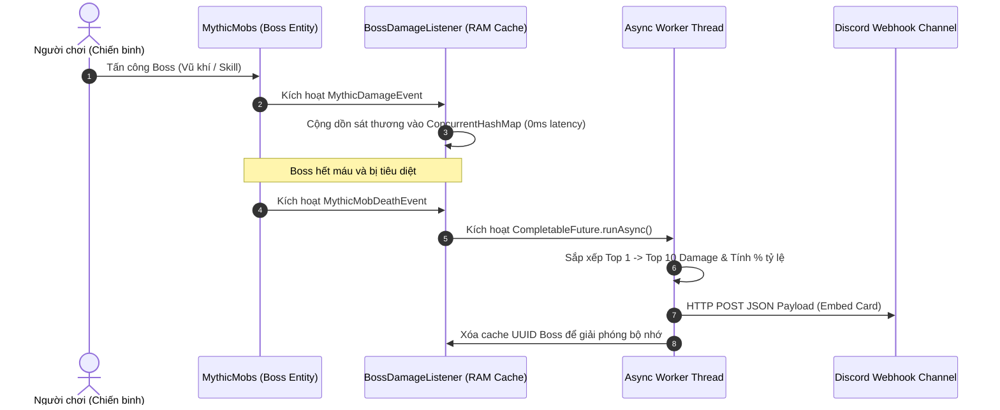

# ==============================================================================
# TÀI LIỆU KỸ THUẬT & HƯỚNG DẪN TÍCH HỢP (WIKI / DOCS)
# MODULE: NovusMC Boss Top Damage Webhook (Async Discord Integration)
# ==============================================================================
**Phiên bản:** `1.0.0`  
**Hỗ trợ nền tảng:** Paper 1.21+ (Java 21)  
**Phụ thuộc (Dependencies):** MythicMobs (v5.x+), NovusMCDiscordAll (hoặc chạy độc lập)  
**Tác giả:** NovusMC Development Team  

---

## 1. Giới thiệu tổng quan
**Boss Top Damage Discord Module** là giải pháp tính toán bảng xếp hạng sát thương đánh Boss MythicMobs và gửi báo cáo tự động sang kênh Discord qua Webhook.

Trước đây, hệ thống này được chạy thông qua tệp Skript dài gần 1,600 dòng (`boss_top_damage_discord_webhook_*.sk`). Mỗi đòn đánh của người chơi vào boss đều phải kích hoạt parser Skript và gửi HTTP request đồng bộ, dẫn đến tình trạng máy chủ bị **tụt TPS nghiêm trọng (khựng giật)** khi có từ 20 đến 50 người cùng tham gia săn boss.

### Ưu điểm kỹ thuật vượt trội của bản Java:
- **Tích lũy sát thương trên RAM:** Sử dụng `ConcurrentHashMap<UUID, Map<String, Double>>` được đồng bộ hóa đa luồng, cho phép ghi nhận hàng trăm đòn đánh mỗi giây mà mức tiêu hao CPU xấp xỉ 0%.
- **Bất đồng bộ 100% (Non-blocking I/O):** Sử dụng `CompletableFuture.runAsync()` kết hợp với `java.net.http.HttpClient` hiện đại của Java 21 để tổng hợp và gửi gói tin HTTP JSON sang Discord hoàn toàn ở luồng phụ (Worker Thread).
- **Không bao giờ làm lag máy chủ:** Khi boss ngã xuống, TPS máy chủ giữ vững **20.0 TPS** tuyệt đối.

---

## 2. Luồng hoạt động của Module (Architecture Flow)



---

## 3. Cấu trúc Báo cáo Discord (Embed Format)

Khi Boss bị hạ gục, tin nhắn Discord Embed sẽ được gửi vào kênh chỉ định với định dạng chuyên nghiệp:

- **Tiêu đề:** `⚔️ CHIẾN BÁO HẠ GỤC BOSS ⚔️`
- **Màu sắc Embed:** Màu Đỏ Chiến Trận (`#E74C3C` / `15158332`)
- **Nội dung:**
  - 👾 **Tên Boss:** Tên hiển thị đầy đủ của Boss theo cấu hình MythicMobs (ví dụ: *Nanh Tai Ương - Direfang*, *Warlord Kragan*, *Bowmaster Vael*).
  - 💥 **Tổng sát thương:** Tổng lượng sát thương toàn bộ người chơi gây ra.
  - 🏆 **Bảng xếp hạng Top 10:**
    - 🥇 **#1 PlayerName**: 1,250,000 ST (35.2%)
    - 🥈 **#2 PlayerName**: 890,000 ST (25.1%)
    - 🥉 **#3 PlayerName**: 520,000 ST (14.6%)
    - ▫️ **#4 PlayerName**: 310,000 ST (8.7%)
    - ...
  - 🕒 **Dấu thời gian:** Tự động đính kèm ISO-8601 Timestamp.

---

## 4. Danh sách Boss được theo dõi (Monitored Bosses)
Mặc định module lọc và tự động lắng nghe sát thương đối với các loại quái boss lớn:
1. `Direfang` (Nanh Tai Ương)
2. `warlord_kragan_the_bloodfury` (Warlord Kragan)
3. `bowmaster_vael_the_ranger` (Bowmaster Vael)
4. Mọi quái MythicMobs có chứa từ khóa `boss`, `warlord`, `vael` trong tên mã định danh nội bộ (`internalName`).

---

## 5. Hướng dẫn Tích hợp vào Plugin `NovusMCDiscordAll`

1. **Thêm Listener vào lớp chính của plugin:**
   ```java
   String webhookUrl = getConfig().getString("webhook.boss-damage-url", "https://discord.com/api/webhooks/...");
   getServer().getPluginManager().registerEvents(new BossDamageListener(this, webhookUrl), this);
   ```
2. **Cấu hình đường dẫn Webhook trong `config.yml`:**
   ```yaml
   webhook:
     boss-damage-url: "https://discord.com/api/webhooks/YOUR_WEBHOOK_ID/YOUR_WEBHOOK_TOKEN"
   ```
3. **Biên dịch và thay thế:**
   Tắt server, thay tệp jar cập nhật vào thư mục `plugins/`, sau đó khởi động lại server.
